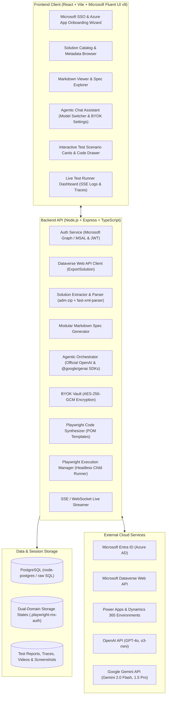

# System Architecture & Technical Specification: Power Platform & Copilot QA Platform (pp-qa)

## 1. Executive Overview

**pp-qa** is an automated testing, inspection, and verification platform designed specifically for Microsoft Power Platform (Model-Driven Apps, Canvas Apps) and Microsoft Copilot Studio (Power Virtual Agents) solutions.

The system automates the complete lifecycle:
1. **Authentication & Connection**: Microsoft Entra ID SSO with user-configured Azure App credentials.
2. **Solution Ingestion**: Automated export and extraction of unmanaged Power Platform solutions from Dataverse (with manual ZIP fallback).
3. **Deep Metadata Extraction**: Parsing of Dataverse tables, columns, relationships, cloud flows, and Copilot topics into PostgreSQL and modular Markdown documentation.
4. **Agentic BYOK Chat**: Multi-model AI assistant powered by official OpenAI and Gemini SDKs with tool-calling capabilities.
5. **Interactive Test Authoring**: Two-stage test generation producing structured scenario cards editable via chat, compiling into robust TypeScript Playwright tests modeled after `microsoft/power-platform-playwright-samples`.
6. **Headless Execution & Reporting**: Dual-domain session authentication (`storageState.json`), headless test runs, real-time streaming execution logs, failure traces/screenshots, and rich test dashboards.

---

## 2. System Architecture & Component Diagram



---

## 3. Directory Layout (Clean Two-Tier Structure)

```
pp-qa/
├── package.json                   # Root package with orchestration scripts (dev, build, test)
├── README.md                      # Project overview and quick start guide
├── ARCHITECTURE.md                # System design & architecture specification
├── .gitignore
├── client/                        # Frontend: React 18 + Vite + Microsoft Fluent UI v9 (@fluentui/react-components)
│   ├── index.html
│   ├── package.json
│   ├── vite.config.ts
│   ├── tsconfig.json
│   └── src/
│       ├── main.tsx
│       ├── App.tsx
│       ├── api/                   # Typed API clients for backend endpoints
│       ├── components/            # Reusable UI components (Modals, Cards, Editors)
│       │   ├── auth/              # Microsoft SSO & Azure App Onboarding Wizard
│       │   ├── solutions/         # Solution list, ingestion progress, metadata trees
│       │   ├── markdown/          # Modular Markdown viewer with table of contents
│       │   ├── chat/              # Chat drawer, model selector, BYOK modal
│       │   ├── tests/             # Test scenario cards, step editor, code drawer
│       │   └── runner/            # Live SSE log console, pass/fail timeline, artifact viewer
│       ├── hooks/                 # Custom React hooks (useAuth, useSolutions, useChatStream)
│       └── pages/                 # Route pages
├── server/                        # Backend: Node.js + Express + TypeScript
│   ├── package.json
│   ├── tsconfig.json
│   ├── src/
│   │   ├── index.ts               # Express server entry point & SSE endpoints
│   │   ├── config/                # Environment variables and encryption keys
│   │   ├── db/                    # PostgreSQL raw SQL connection & migration runner
│   │   │   ├── pool.ts            # node-postgres Pool configuration
│   │   │   ├── migrations/        # SQL migration files
│   │   │   │   ├── 001_initial_schema.sql
│   │   │   │   └── 002_byok_and_tests.sql
│   │   │   └── queries/           # Typed SQL query functions
│   │   ├── services/
│   │   │   ├── auth.service.ts    # Microsoft SSO, JWT issuance, Azure App profile management
│   │   │   ├── dataverse.service.ts # Dataverse Web API client (query solutions, ExportSolution)
│   │   │   ├── parser/            # Solution ZIP and XML/JSON extraction engine
│   │   │   │   ├── zipExtractor.ts
│   │   │   │   ├── solutionXmlParser.ts
│   │   │   │   ├── customizationsParser.ts
│   │   │   │   ├── cloudFlowParser.ts
│   │   │   │   ├── copilotBotParser.ts
│   │   │   │   └── markdownGenerator.ts
│   │   │   ├── ai/                # Multi-model AI agent engine
│   │   │   │   ├── byok.service.ts    # AES-256-GCM key encryption & retrieval
│   │   │   │   ├── openai.client.ts   # Official OpenAI SDK wrapper with tools
│   │   │   │   ├── gemini.client.ts   # Official @google/genai SDK wrapper with tools
│   │   │   │   ├── agent.tools.ts     # Metadata search, test proposal tools
│   │   │   │   └── prompts.ts         # System prompts for Power Platform test engineering
│   │   │   ├── testgen/           # Playwright TypeScript code generator
│   │   │   │   ├── pomTemplates.ts    # Page Object Model templates based on MS samples
│   │   │   │   └── testSynthesizer.ts
│   │   │   └── runner/            # Playwright execution engine
│   │   │       ├── authSessionManager.ts # Dual storageState (.playwright-ms-auth) manager
│   │   │       ├── executionQueue.ts     # Background test runner with live SSE logging
│   │   │       └── reportCollector.ts    # Parses test results, captures screenshots/traces
│   │   ├── routes/                # Express REST routers
│   │   └── utils/
│   └── playwright/                # Embedded Playwright runner runtime
│       ├── playwright.config.ts
│       ├── .playwright-ms-auth/   # Dual storage state cache (state-*.json)
│       ├── templates/             # Base POM classes (AppProvider, ModelDrivenAppPage, GridComponent)
│       └── generated-tests/       # Workspace for generated test suites
```

---

## 4. Database Schema (PostgreSQL with Raw `pg`)

The database uses PostgreSQL with typed SQL queries. No ORM is used, guaranteeing direct query performance and straightforward migrations.

### Core Tables
1. **`users`**:
   - `id` (UUID, PK)
   - `microsoft_oid` (VARCHAR, UNIQUE) - Entra ID Object ID
   - `email` (VARCHAR, UNIQUE)
   - `display_name` (VARCHAR)
   - `created_at`, `updated_at` (TIMESTAMP)

2. **`azure_app_profiles`**:
   - `id` (UUID, PK)
   - `user_id` (UUID, FK -> users)
   - `profile_name` (VARCHAR)
   - `tenant_id` (VARCHAR)
   - `client_id` (VARCHAR)
   - `encrypted_client_secret` (TEXT) - AES-256-GCM encrypted
   - `environment_url` (VARCHAR) - e.g., `https://org123.crm.dynamics.com`
   - `is_active` (BOOLEAN)
   - `created_at`, `updated_at` (TIMESTAMP)

3. **`byok_keys`**:
   - `id` (UUID, PK)
   - `user_id` (UUID, FK -> users, NULL for global org keys)
   - `provider` (VARCHAR) - `'openai'` or `'gemini'`
   - `encrypted_api_key` (TEXT) - AES-256-GCM encrypted
   - `key_hint` (VARCHAR) - e.g., `sk-...39aF`
   - `created_at`, `updated_at` (TIMESTAMP)

4. **`solutions`**:
   - `id` (UUID, PK)
   - `user_id` (UUID, FK -> users)
   - `unique_name` (VARCHAR)
   - `friendly_name` (VARCHAR)
   - `version` (VARCHAR)
   - `is_managed` (BOOLEAN DEFAULT false)
   - `publisher_name` (VARCHAR)
   - `publisher_prefix` (VARCHAR)
   - `markdown_content` (TEXT) - Full generated specification
   - `raw_metadata` (JSONB) - Comprehensive parsed metadata
   - `zip_storage_path` (VARCHAR)
   - `created_at`, `updated_at` (TIMESTAMP)

5. **`solution_tables`**:
   - `id` (UUID, PK)
   - `solution_id` (UUID, FK -> solutions)
   - `schema_name` (VARCHAR)
   - `display_name` (VARCHAR)
   - `primary_id_attribute` (VARCHAR)
   - `primary_name_attribute` (VARCHAR)
   - `columns` (JSONB) - List of attributes (types, requiredness, optionsets, lookups)
   - `relationships` (JSONB) - 1:N, N:1, N:N relationships

6. **`solution_flows`**:
   - `id` (UUID, PK)
   - `solution_id` (UUID, FK -> solutions)
   - `workflow_id` (VARCHAR)
   - `name` (VARCHAR)
   - `trigger_type` (VARCHAR)
   - `triggers` (JSONB)
   - `actions` (JSONB)
   - `connection_references` (JSONB)

7. **`solution_copilot_bots`**:
   - `id` (UUID, PK)
   - `solution_id` (UUID, FK -> solutions)
   - `bot_schema_name` (VARCHAR)
   - `display_name` (VARCHAR)
   - `topics` (JSONB) - Trigger phrases, dialog steps, generative answers, knowledge sources

8. **`test_suites`**:
   - `id` (UUID, PK)
   - `solution_id` (UUID, FK -> solutions)
   - `title` (VARCHAR)
   - `description` (TEXT)
   - `target_app_type` (VARCHAR) - `'model_driven'`, `'canvas'`, or `'copilot'`
   - `target_app_name` (VARCHAR)
   - `scenarios` (JSONB) - Structured test scenarios (id, title, preconditions, steps, assertions)
   - `generated_code` (TEXT) - TypeScript Playwright test script
   - `created_at`, `updated_at` (TIMESTAMP)

9. **`test_runs`**:
   - `id` (UUID, PK)
   - `test_suite_id` (UUID, FK -> test_suites)
   - `status` (VARCHAR) - `'queued'`, `'running'`, `'passed'`, `'failed'`, `'error'`
   - `duration_ms` (INTEGER)
   - `summary` (JSONB) - Total, passed, failed, skipped counts
   - `logs` (TEXT) - Raw terminal and step logs
   - `report_url` (VARCHAR) - Path to Playwright HTML report
   - `artifacts` (JSONB) - Array of screenshots, videos, trace files
   - `started_at`, `completed_at` (TIMESTAMP)

---

## 5. Power Platform Metadata Extraction Deep Dive

When an unmanaged solution ZIP is unpacked, the parser extracts:
1. **`solution.xml`**:
   - Solution metadata (version, publisher details, customization prefix).
   - `RootComponents`: Inventory of all entities, web resources, option sets, workflows, app modules, canvas apps, and bot components.
2. **`customizations.xml`**:
   - **Entities / Tables**: SchemaName, ObjectTypeCode, Attributes (type: String, Integer, DateTime, Boolean, Lookup, OptionSet, State, Status, Money), RequiredLevel, MaxLength.
   - **Entity Relationships**: RelationshipType (OneToMany, ManyToOne, ManyToMany), ReferencingEntity, ReferencedEntity, CascadeDelete rules.
   - **Forms (SystemForms)**: FormXml parsing into tabs, sections, fields, subgrids, and custom script events.
   - **Views (SavedQueries)**: FetchXml and column layouts.
3. **`Workflows/*.json`**:
   - Cloud Flow definitions: Trigger type (Dataverse row created/modified/deleted, recurrence, manual, HTTP), action steps (Dataverse CRUD, conditions, scope blocks, error handling), and connection references.
4. **`AppModules/*.xml`**:
   - Model-Driven Apps: Unique name, navigation sitemap, included entities, business process flows, dashboards.
5. **`CanvasApps/*.msapp`**:
   - Unpacked screens, control hierarchy, data sources, and Power Fx formulas.
6. **`Bots/` & `BotComponents/`**:
   - Copilot Studio bot schema, topics (intents, adaptive cards, generative answers nodes, tool calls).
7. **`Connectors/` & `ConnectionReferences/`**:
   - Custom connectors (OpenAPI specifications) and connection references mapping logic.

---

## 6. Microsoft Playwright Integration (`microsoft/power-platform-playwright-samples`)

### Core Patterns Leveraged:
1. **Dual-Domain Authentication Sessions (`storageState`)**:
   - Power Apps Domain (`make.powerapps.com`): `state-<email>.json` for Canvas apps and Maker portal actions.
   - Dynamics 365 / Dataverse Domain (`*.crm.dynamics.com`): `state-mda-<email>.json` for Model-Driven Apps.
   - Session generation via:
     - Automated headless credential login with environment credentials (`MS_AUTH_EMAIL`, `MS_USER_PASSWORD`).
     - Interactive session capture modal in the application for MFA-enabled accounts.
2. **Page Object Models (POM)**:
   - `AppProvider`: Handles environment navigation, app launcher, and initial ready checks.
   - `ModelDrivenAppPage`: Handles command bar buttons, form navigation, tab switching, and saving.
   - `GridComponent`: Handles Dataverse entity view grids, column sorting, filtering, row selection, and quick find.
   - `FormComponent`: Handles typed inputs (text fields, lookup pickers, option sets, date pickers, subgrid rows).
   - `CopilotChatComponent`: Interacts with embedded Copilot Studio chat widgets, sends test prompts, and verifies generative answers and adaptive cards.
3. **Intelligent Waiters**:
   - Built-in waiting for Dataverse client-side spinners (`ms-spinner`), command bar animation completion, and async subgrid data loads, preventing flaky test failures.

---

## 7. Execution Roadmap

1. **Phase 1: Project Scaffolding & Database Setup**
   - Initialize root, `client/` (Vite + React 18 + Microsoft Fluent UI v9), and `server/` (Node.js + Express + TypeScript).
   - Set up PostgreSQL database with raw `pg` client and migration scripts.
2. **Phase 2: Authentication & Azure App Integration**
   - Implement Microsoft Entra ID SSO on frontend and backend.
   - Build Azure App onboarding wizard (Tenant ID, Client ID, Secret, Environment URL).
   - Test Dataverse Web API connection and unmanaged solution discovery.
3. **Phase 3: Solution Extractor & Markdown Generator**
   - Build ZIP extractor and XML/JSON parser for `solution.xml`, `customizations.xml`, flows, apps, and bots.
   - Generate modular Markdown specification and store structured records in PostgreSQL.
4. **Phase 4: Agentic Chat Assistant (BYOK + Tools)**
   - Implement AES-256 encrypted BYOK vault for OpenAI & Gemini.
   - Create direct tool-calling loops with official `openai` and `@google/genai` SDKs.
   - Build interactive chat UI with model selector and semantic metadata search.
5. **Phase 5: Interactive Test Case Authoring**
   - Implement two-stage test authoring: interactive scenario cards + TypeScript Playwright synthesizer using Microsoft's POM templates.
6. **Phase 6: Playwright Headless Runner & Reporting Dashboard**
   - Set up headless Playwright execution environment with dual `storageState` authentication.
   - Build live SSE streaming logs, pass/fail timeline, screenshot/trace viewer, and Playwright HTML report integration.

